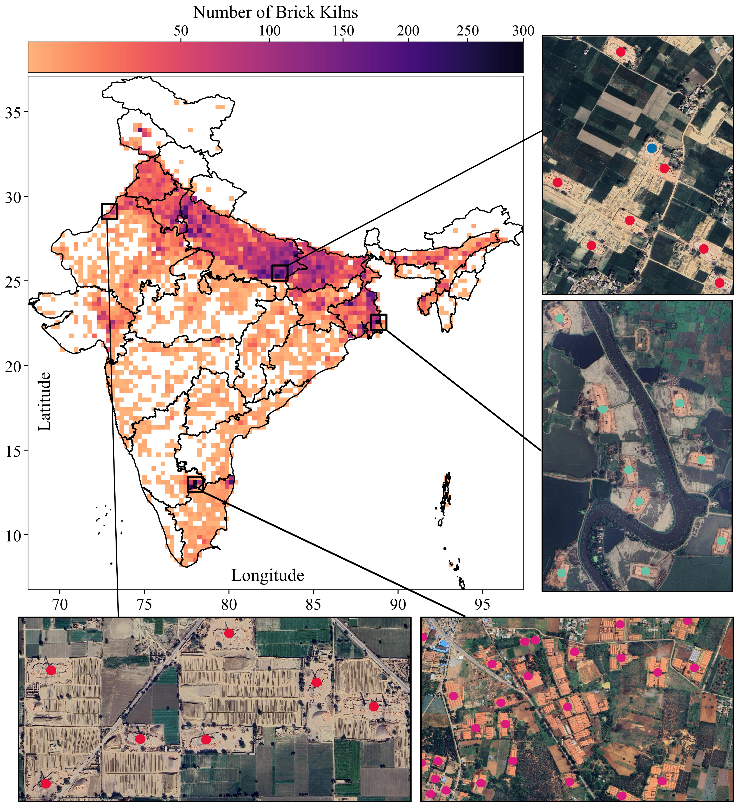
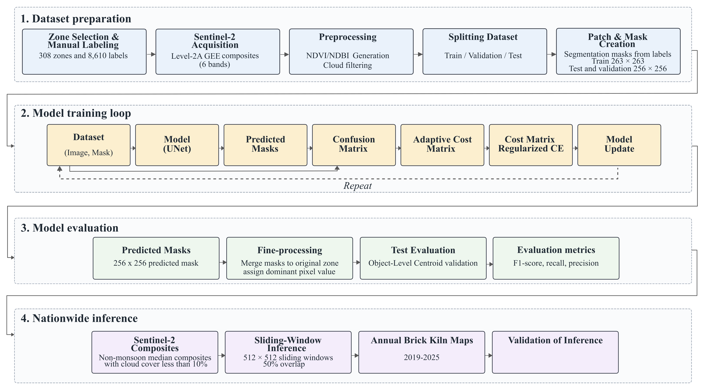
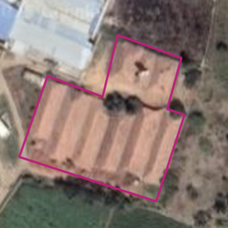
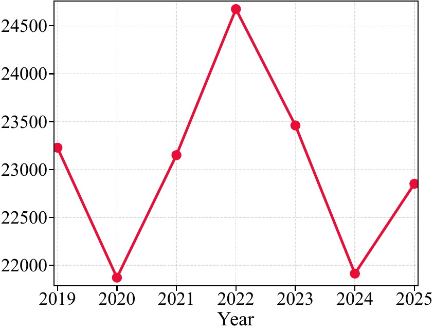
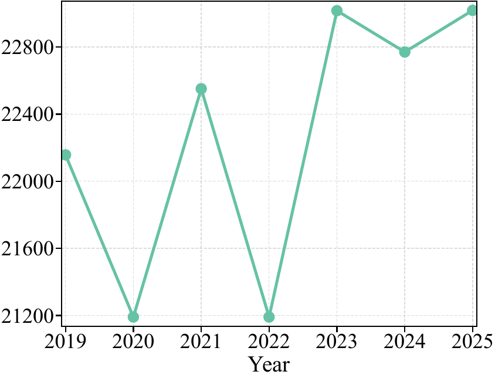
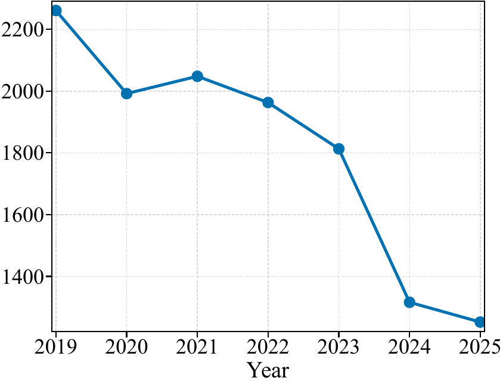
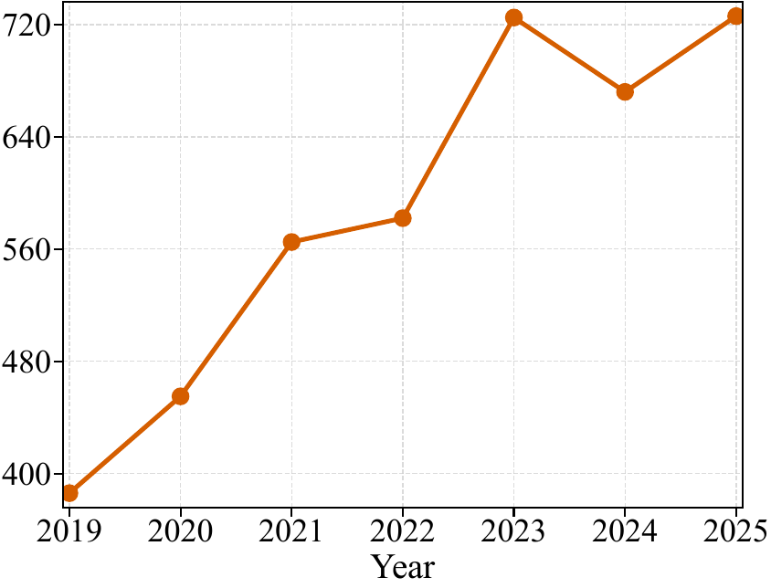
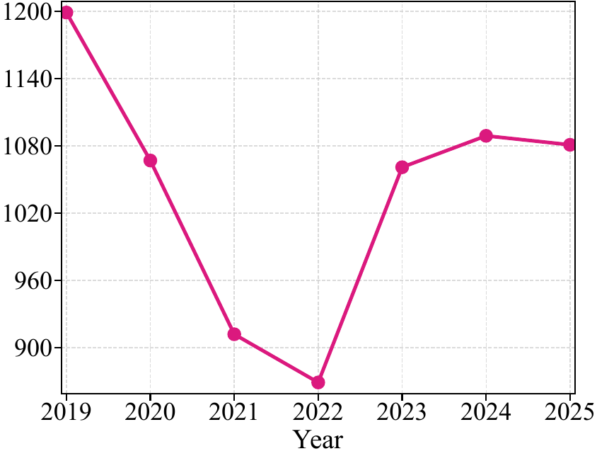

# Brick Kilns Across India: A Temporal Analysis of Brick Kiln Distribution and Technology Types [JAG 2026]

Sugandha Arora, Clément Goldmann, Stefan Oehmcke, [Jan Pauls](https://www.wi.uni-muenster.de/de/institut/dasc/personen/jan-pauls), Chuanlong Zhou, Abhinav Sharma, Kushal Tibrewal, Harish C. Phuleria, [Fabian Gieseke](https://www.wi.uni-muenster.de/department/dasc/people/fabian-gieseke), [Philippe Ciais](https://www.lsce.ipsl.fr/Phocea/Pisp/index.php?nom=philippe.ciais)

[[`Paper`](https://doi.org/10.1016/j.jag.2026.105496)] [[`MuTBriK dataset & kiln maps`](https://doi.org/10.5281/zenodo.18301279)] [[`BibTeX`](#citing-the-paper)]

[](https://doi.org/10.5281/zenodo.18301279)



We present the **first nationwide, multi-year maps of brick kilns in India (2019–2025)**, including the kiln technology type, derived from freely available 10 m Sentinel-2 imagery. A U-Net semantic segmentation model is trained on **MuTBriK**, a new open dataset of 10,480 Sentinel-2 images covering 20,356 km² across India with pixel-level labels for five kiln technologies: Fixed Chimney Bull's Trench Kiln (FCBTK), Zigzag, Circular BTK (CBTK), Roofed BTK (RBTK), and Down Draught Kiln (DDK). To separate visually similar technologies, such as FCBTK and Zigzag, we propose a **Confusion-Matrix-Regularized Cross-Entropy (CMR-CE)** loss that penalizes the class pairs the model confuses most often. The model reaches about **93% kiln detection** and **81% technology classification** accuracy on the held-out test set, and detects **48,928 kilns in 2025**. The annual maps show a slow but steady shift from FCBTK toward cleaner Zigzag kilns, and a roughly 50% decline in the older CBTK design.



## Kiln technologies

| Class ID | Kiln type | Appearance in imagery |
|---|---|---|
| 0 | Background | – |
| 1 | FCBTK – Fixed Chimney Bull's Trench Kiln | Oval |
| 2 | Zigzag | Rectangular |
| 3 | CBTK – Circular Bull's Trench Kiln | Circular |
| 4 | RBTK – Roofed Bull's Trench Kiln | Oval or rectangular, with roof |
| 5 | DDK – Down Draught Kiln | Cluster of orange-roofed buildings around a chimney |

<table>
  <tr>
    <td align="center"><br>FCBTK</td>
    <td align="center"><br>Zigzag</td>
    <td align="center"><br>CBTK</td>
    <td align="center"><br>RBTK</td>
    <td align="center"><br>DDK</td>
  </tr>
</table>

## Results

Object-level kiln detection on the test set:

| Loss | Precision | Recall | F1 |
|---|---|---|---|
| CE | 93.75 | 92.09 | 92.91 |
| **CMR-CE (ours)** | **93.86** | **93.72** | **93.79** |

Object-level technology classification on the test set (F1, macro / micro):

| Loss | F1 (macro) | F1 (micro) |
|---|---|---|
| CE | 0.8101 | 0.7793 |
| **CMR-CE (ours)** | **0.8178** | **0.8099** |

Nationwide kiln counts by technology:

| Year | FCBTK | Zigzag | CBTK | RBTK | DDK | Total |
|---|---|---|---|---|---|---|
| 2019 | 23,228 | 22,157 | 2,261 | 386 | 1,199 | 49,231 |
| 2020 | 21,871 | 21,191 | 1,992 | 455 | 1,067 | 46,576 |
| 2021 | 23,150 | 22,551 | 2,048 | 565 | 912 | 49,226 |
| 2022 | 24,675 | 21,191 | 1,963 | 582 | 869 | 49,280 |
| 2023 | 23,460 | 23,016 | 1,813 | 725 | 1,061 | 50,075 |
| 2024 | 21,913 | 22,770 | 1,316 | 672 | 1,089 | 47,760 |
| 2025 | 22,851 | 23,018 | 1,252 | 726 | 1,081 | 48,928 |

Number of detected kilns per year (2019–2025) for each technology:

<table>
  <tr>
    <td align="center"><br>FCBTK</td>
    <td align="center"><br>Zigzag</td>
    <td align="center"><br>CBTK</td>
    <td align="center"><br>RBTK</td>
    <td align="center"><br>DDK</td>
  </tr>
</table>

## Data

### MuTBriK dataset

The Multi-Type Brick Kilns dataset contains monthly median Sentinel-2 L2A composites as 8-band GeoTIFFs with matching pixel-wise label masks (class IDs 0–5, see above), split into train, validation and test sets. Training patches are 263 × 263 pixels; validation and test patches are 256 × 256 pixels.

| Channel | Band | Notes |
|---|---|---|
| 1 | B2 – Blue | 10 m |
| 2 | B3 – Green | 10 m |
| 3 | B4 – Red | 10 m |
| 4 | B8 – NIR | 10 m |
| 5 | B11 – SWIR1 | 20 m, resampled to 10 m |
| 6 | B12 – SWIR2 | 20 m, resampled to 10 m |
| 7 | NDVI | (B8 − B4) / (B8 + B4) |
| 8 | NDBI | (B11 − B8) / (B11 + B8) |

Reflectance values are scaled by dividing by 10,000.

| Split | Patches | Kilns |
|---|---|---|
| Train | 8,578 | 5,958 |
| Validation | 915 | 1,299 |
| Test | 987 | 1,353 |

Download from Zenodo: [10.5281/zenodo.18301279](https://doi.org/10.5281/zenodo.18301279)

Expected folder structure:

```
MuTBriK/
├── Train/
│   ├── Image/   *.tif
│   └── Mask/    *.tif
├── Validation/
│   ├── Image/
│   └── Mask/
└── Test/
    ├── Image/
    └── Mask/
```

### Nationwide kiln maps (2019–2025)

Annual kiln locations with technology labels for India (2019–2025) are included in the same Zenodo record as `Maps_GeoJSON.zip`, with one file per year (e.g. `India_2019.geojson`).

Each kiln is a point (its centroid) in WGS84 (longitude, latitude), with two attributes:

| Column | Description |
|---|---|
| `type` | Kiln technology: `FCBTK`, `Zigzag`, `CBTK`, `RBTK` or `DDK` |
| `STATE` | Indian state the kiln is located in |

```python
import geopandas as gpd

kilns = gpd.read_file("India_2019.geojson")
print(kilns["type"].value_counts())                       # kilns per technology
print(kilns.groupby(["STATE", "type"]).size().unstack())  # per state and technology
```

## Training

Clone the repository and install the dependencies:

```
git clone https://github.com/ssugandh01/MuTBriK.git
cd MuTBriK
pip install -r requirements.txt
```

Train with the paper's default settings (CMR-CE loss):

```
python train.py --data_dir /path/to/MuTBriK
```

Train the plain cross-entropy baseline from the ablation:

```
python train.py --data_dir /path/to/MuTBriK --loss ce
```

Or run both as a Weights & Biases sweep (set `--data_dir` in `configs/sweep.yaml` first):

```
wandb sweep configs/sweep.yaml
wandb agent <sweep-id>
```

Runs are logged to Weights & Biases. To train without a wandb account, set `WANDB_MODE=disabled` before the command. Each run writes the best model, a training log, test metrics (per-class IoU, precision, recall, F1) and confusion matrices to `outputs/`.

Default setup from the paper: U-Net with an EfficientNet-B7 encoder trained from scratch (random initialization; use `--encoder_weights imagenet` for an ImageNet-pretrained encoder), 250 epochs with AdamW (learning rate 1e-3, weight decay 1e-4), 5 warm-up epochs followed by cosine annealing, batch size 16, random 256×256 crops with flips and rotations, and per-patch min-max normalization. With CMR-CE, the model trains with plain cross-entropy during the warm-up epochs; afterwards, the cost matrix is rebuilt from the training confusion matrix after every epoch (β = 5, clip = 3, EMA α = 0.2, λ = 1). The checkpoint with the best validation mIoU over the kiln classes is kept. Run `python train.py --help` for all options.

## Nationwide inference

`inference/predict_india.py` runs the trained model over full Sentinel-2 tiles with an overlapping sliding window (512 × 512 windows, 50% overlap). Softmax outputs of overlapping windows are averaged, and each pixel gets the most probable class. The output is one single-band GeoTIFF per tile with class IDs 0–5.

Input tiles are 6-band GeoTIFFs in the order B2, B3, B4, B8, B11, B12. In the paper, these are annual median composites (cloud cover < 10%) over the non-monsoon months (January–May and September–December). NDVI and NDBI are computed inside the script.

```
python inference/predict_india.py \
    --input_dir  /path/to/sentinel2_tiles \
    --output_dir /path/to/predictions \
    --model_path /path/to/unet_b7_best_model.pth
```

To run inference, first train a model with `train.py` (see [Training](#training)). The trained weights are available from the authors on request.

## Post-processing

`postprocessing/` converts the predicted rasters into the kiln maps released on Zenodo: connected components are extracted, each kiln gets the majority class of its pixels, and its centroid is written to GeoJSON.

TODO: usage instructions

## Repository structure

```
MuTBriK/
├── README.md
├── LICENSE
├── requirements.txt
├── configs/sweep.yaml          # W&B sweep configuration
├── train.py                    # model training (CMR-CE loss)
├── data_download/              # Sentinel-2 composites from Google Earth Engine
├── inference/predict_india.py  # nationwide sliding-window inference
├── postprocessing/             # rasters → kiln centroids (GeoJSON)
└── figures/
```

## Acknowledgements

This work was supported by the Grantham Foundation through the CHETNA project, and by the German Federal Ministry of Education and Research (BMBF) through the project *AI4Forest* (01IS23025A).

## Citing the paper

If you use the dataset, the maps or the code in your research, please cite:

```bibtex
@article{arora2026brickkilns,
  title   = {Brick kilns across India: A temporal analysis of brick kiln distribution and technology types},
  author  = {Arora, Sugandha and Goldmann, Cl{\'e}ment and Oehmcke, Stefan and Pauls, Jan and Zhou, Chuanlong and Sharma, Abhinav and Tibrewal, Kushal and Phuleria, Harish C. and Gieseke, Fabian and Ciais, Philippe},
  journal = {International Journal of Applied Earth Observation and Geoinformation},
  volume  = {153},
  pages   = {105496},
  year    = {2026},
  doi     = {10.1016/j.jag.2026.105496}
}
```

## License

The code in this repository is released under the [MIT License](LICENSE). The MuTBriK dataset and the kiln maps are released under [CC BY 4.0](https://creativecommons.org/licenses/by/4.0/), and the paper is open access under the same license.
